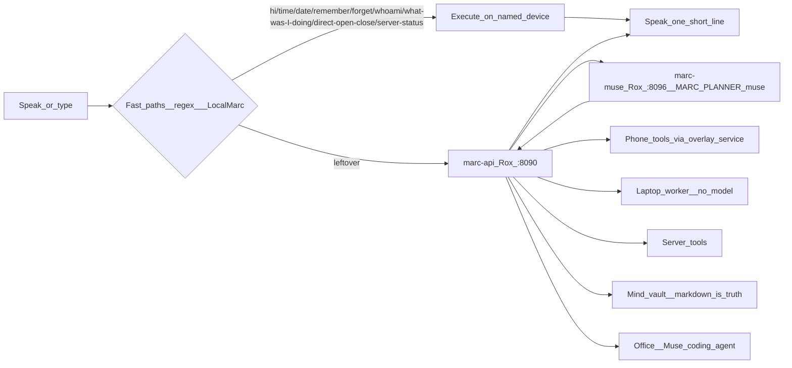

# Marc — Product Requirements Document

**Product:** Marc (desk still branded **Roxx**)
**Owner / only user:** Ranjith
**Status:** Live personal system (not a public product)
**Planner:** Meta Muse on Rox loopback `:8096` (`MARC_PLANNER=muse`)
**Mode:** `MARC_MODE=sandbox|live`, default `sandbox`
**Out of scope:** TV Lock, any TV / YouTube parental remote, and any IR or device remote-controller. Those are a separate product.

This document is the live product spec for Muse Marc. It describes the assistant as it actually runs: home-server coordinator, phone overlay + Chat, web desk, laptop worker, mind vault, and Office coding agent.

---

## 1. Problem

Ranjith needs one assistant that:

- Hears or reads a short command
- Decides **which machine** should act (phone, laptop, home server)
- **Does the thing**, then speaks a one-line result
- Remembers where work left off without being asked to recap
- Never sends a message, mail, or invite without an explicit confirm

He should not open Settings, ADB, SSH, or a chat model UI for everyday actions.

---

## 2. Product vision

Marc is a **personal action assistant**, not a chatbot.

- Typed or spoken input becomes **tools**, not essays
- Fast local regex / LocalMarc phrases skip models entirely
- Leftover commands are planned by **Meta Muse** on Rox (`marc-muse` on loopback `:8096`)
- Needle / Laya / Qwen binaries may remain installed **only for rollback** (`MARC_PLANNER=needle`) but **must not be called when planner is `muse`**
- Memory is an Obsidian markdown vault on the home server; SQLite is an index, not the soul
- Sandbox is the default: drafts queue, never auto-send

**North star:** Say it once. The right device does it. Marc still knows what you were doing tomorrow — and never sends without asking.

---

## 3. Users and devices

| Role | Device | Role in the product |
|------|--------|---------------------|
| Ranjith | Nothing Phone (3a) Lite | Primary mouth and hands: camera-cutout overlay, Chat, queued phone tools |
| Ranjith | Windows laptop | Hands for apps, mail, search, YouTube, typing |
| Home Linux host **Rox** | Always-on coordinator | `marc-api`, `marc-muse`, mind vault, desk (Roxx), Office agent |

Single-user. Bearer token (`MARC_TOKEN`) on every coordinator call. No accounts, no multi-tenant, no manufacturing/cloud product stack. Owner is Ranjith.

---

## 4. Goals

1. **Act locally first.** Open, type, YouTube, Google, Spotify, WhatsApp on the phone without waiting for Rox.
2. **Plan leftovers with Muse.** Every leftover becomes a confirmed plan of tool steps with explicit dependencies and kinds.
3. **Reach the other machines.** Laptop tools via the Windows worker; server status/restarts via Rox.
4. **Remember.** `ME.md`, `NOW.md`, daily notes, people files, style cards, desk chat restore.
5. **Sandbox by default.** Mail, WhatsApp, IG, SMS, and calendar invites require confirm-before-send; drafts queue never auto-sends in sandbox.
6. **Respect channels and credits.** Gmail = professional, Instagram = friend|stranger, WhatsApp = mixed; Spark vs Wonder meter gates spend.
7. **Stay small and private.** Overlay geometry frozen. No board-name copy in the phone UI. Secrets never committed.
8. **One kill switch.** `POST /muse/stop` halts planning and queued Office work immediately.

---

## 5. Non-goals

- TV Lock, YouTube-on-TV lock, PIN parental remote, extra tablet apps
- Public SaaS, teams, billing
- Free-text chat as the main product (planner returns tools + one short reply, not essays)
- Reboot, shutdown, `sudo`, `rm -rf /` — hard refused everywhere
- Replacing the overlay with a full launcher
- Changing phone overlay geometry (frozen)
- Giving the laptop worker a model (laptop worker has no model; it only executes allowlisted Windows tools)
- Auto-sending drafts in sandbox

---

## 6. Product surfaces



### 6.1 Phone overlay (live app)

- Pill locked to the front-camera cutout (width/height unchanged; **phone overlay geometry frozen**)
- Tap: listen. Long-press: Chat
- Spoken line + optional Yes/No confirm chips
- After an APK update, pill still shows via `TYPE_APPLICATION_OVERLAY` if accessibility was reset; camera-hole taps work fully when Marc is on in Settings → Accessibility
- Routing order: PhoneControls → LocalMarc (including open/type/YouTube/Google) → Rox `POST /utterance` for leftover
- Phone leftover goes to **Rox utterance, not on-device Needle**. On-device Needle is not the live path when `MARC_PLANNER=muse`
- Laptop/server named phrases skip local handling and go to Rox
- Phone leftover failure copy is Muse copy (see §15)

### 6.2 Phone Chat

- Same token, `session_id=phone`, target Auto / Phone / Laptop / Server
- Action-like text goes through the overlay service; small talk hits `/chat`
- Office tab: continue / new / stop against the Office agent (Muse, halted by `POST /muse/stop`)

### 6.3 Web desk (Roxx)

Private Tailscale site. Desk keeps the **Roxx** brand. Pages: Chat, Office, Agent, Mind, Laptop, Phone, Server, Disks, System, Settings. Analog status rings. Presence. Chat restore from the mind vault. Sandbox/live toggle and drafts queue are visible in desk. Credit meter (Spark vs Wonder) is visible in desk.

### 6.4 Laptop worker

No model. Executes allowlisted Windows tools when `MARC_LAPTOP_URL` is set. If the worker is down, Marc says the laptop is not connected instead of hanging. The laptop worker never plans; all planning happens in `marc-muse` on Rox.

---

## 7. Core user loop

1. User speaks or types a short command.
2. **Target:** Auto (session default), or Phone / Laptop / Server. Phrases `on my phone` / `on my laptop` / `on the server` override.
3. **Instant (no model):** hi, time, date, remember/forget, who am I, what was I doing, what's my IP.
4. **Hard refuse:** reboot, shutdown, `sudo`, `rm -rf /`. Refuse in one short line; do not plan around it.
5. **Direct:** single open/close; server status/restart/docker.
6. **Scripted phone:** `open X type Y send it`, `search youtube for …`, `open Google and search for …`.
7. **Leftover → marc-api → marc-muse:** planner returns `reply` + `plan` steps with dependencies, kinds, devices, tools, args, and confirm flags. Confirm-gated steps pause for Yes/No.
8. Execute on the named device. Speak one short line.

Confirm-before-send applies to mail, WhatsApp, IG, SMS, and calendar invites in both sandbox and live. Drafts queue never auto-sends in sandbox.

---

## 8. Feature requirements by device

### 8.1 Phone (must)

| Action | Behavior |
|--------|----------|
| Open / close app | Match launcher label; Spotify pause on close |
| Type into focused field | `type_into`; `send` true on "enter" / "send it" |
| Spotify | `play_music` query or media keys |
| YouTube / Google search | Open that app, type query, submit |
| WhatsApp / SMS / Instagram | Prefill; send only on explicit confirm (see §9, §11) |
| Call | Dial contact or number (confirm-gated) |
| Food | Swiggy / Zomato search |
| Camera | Open or take photo / selfie |
| Follow-ups | next / pause / resume on the app already open |

### 8.2 Laptop (must when worker is up)

Open/close/focus apps, Google/web/YouTube search, play nth result, type, hotkeys, volume, Gmail search/summarize/compose/send (compose/send confirm-gated), calendar list/create (create/invite confirm-gated), Drive search, open URL, system status. Worker has no model.

### 8.3 Home server (must)

| Tool | Allowlist |
|------|-----------|
| `server_status` | CPU, temp, RAM, service health |
| `service_status` / `service_restart` | api, desk, bridge, muse, ollama, n8n |
| `docker_list` / `docker_restart` | n8n only |
| `server_shell` | User `rox`, cwd `/home/rox/marc`, 15s, deny reboot/shutdown/sudo/delete-root |

---

## 9. MARC_MODE: sandbox vs live, confirm-before-send, drafts

`MARC_MODE=sandbox|live`, default `sandbox`.

- **sandbox (default):** Everything that would send externally becomes a **draft**. Drafts queue in `marc-api` + mind vault and are shown in desk/phone for review. Drafts queue **never auto-sends** in sandbox, even after restart.
- **live:** Confirm-gated steps still require an explicit Yes / confirm chip before send. Live only changes that a confirmed draft is actually delivered via the selected mouth (see §11).
- **confirm-before-send** covers: mail compose/send, WhatsApp send, IG send, SMS send, calendar invites/creates. Everyday open/play/type/search does not confirm.
- Confirm prompts name the channel, the recipient, and which mouth will send (personal phone-prefill vs Marc-business Cloud API).
- `CONFIRM_TOOLS` lists the confirm-gated tools; planner must set `confirm: true` on those steps and must not mark them auto-executable.

---

## 10. Credit meter: Spark vs Wonder


- Every Muse plan and Office hop accrues cost against a credit meter.
- Desk shows **Spark vs Wonder** balances: Spark = fast/cheap everyday planning; Wonder = heavier/longer Office and recall work.
- Caps come from env (defaults in `.env.example`): `MARC_CREDIT_DAILY_CAP=8.00` is the shared daily spend ceiling across Spark + Wonder; `MARC_PLAN_MAX_HOPS=8` bounds planner hops per turn and `MARC_PLAN_HARD_HOPS=14` is the absolute hop ceiling — a plan hitting the hard ceiling stops and reports instead of looping. Model names are `MARC_SPARK_MODEL=muse-spark-1.3` / `MARC_WONDER_MODEL=muse-wonder-1.0`.
- When Spark is exhausted, everyday plans pause and Marc says the Muse budget paused variant (see §15).
- When Wonder is exhausted, Office iterate/repeat loops pause; one-shot answers still work if Spark remains.
- Planner must keep plans small (few steps, explicit `after[]`) to conserve credits. `repeat`/`iterate`/`followup` kinds must bound their iterations.

---

## 11. Channel policy, leak guard, two mouths

### Channel policy

- **Gmail = professional.** Full sentences, subject, signature. Default for work, applications, official requests.
- **Instagram = friend|stranger.** Short, casual, no work jargon. Stranger adds one-line context; friend is terse and warm.
- **WhatsApp = mixed.** Professional contacts stay Gmail-formal in tone; friends stay casual. Default to the relationship in `people/`.
- **IG + WA overlap = friend.** If the same person exists on both IG and WA, the friend tone wins unless the user explicitly says work.

### Leak guard

No professional mail facts leak into IG/WA unless `work_ok` is true for that step. Planner must set `work_ok: true` explicitly only when the user said the work topic may be shared on that casual channel. Otherwise:

- Strip company names, offer details, salary, interview panels, internal links, and mail quotes from IG/WA drafts.
- Replace with a neutral pointer ("will mail you the details") instead of summarizing the mail.
- Desk flags drafts that trip the guard.

### Two mouths

- **Personal (phone-prefill):** Marc prefills the phone app (Gmail/WhatsApp/IG/SMS) and the user taps send. Default in sandbox and default for personal contacts.
- **Marc-business (Cloud API):** Server-side send via the business Cloud API for approved Marc-business identities. Only used when the plan step selects it, the channel allows it, and confirm was given. Sandbox never fires this mouth; it drafts instead.

---

## 12. Mind (brain)

The brain is an **Obsidian markdown vault**. Markdown is the soul; SQLite is the index only.

Vault (on Rox, e.g. `/home/rox/marc/mind`):

- `ME.md` — who Ranjith is, preferences, standing instructions
- `NOW.md` — current focus, last actions, open loops, Office pointer
- `daily/YYYY-MM-DD.md` — append-only day log
- `projects/` — durable project notes
- `people/` — one file per person: channels, relationship (friend|professional|stranger), overlap flags
- `style cards` — per-channel tone cards (Gmail-professional, IG-friend, IG-stranger, WA-mixed)
- `chat/` — desk/phone transcripts for restore

SQLite `FTS+vec` is **INDEX only, not the soul**: full-text + vector index over the vault for fast recall. Rebuildable from markdown at any time. Never treat SQLite as authoritative if markdown disagrees.

**Spoken:** "what was I doing", "remember …", "forget …", "who am I".
**Muse tools on Rox:** `mind_now`, `mind_note`, `mind_recall` (read/write through `marc-api` so every utterance and Office hop keeps `NOW.md` and the day log current).

---

## 13. Office

- Office leftover coding agent is **Muse**, not Cursor composer-2.5.
- Work dir: `/home/rox/office/work` (optional SSH mount).
- Desk and phone: New task / Continue / Stop. Stop fires `POST /muse/stop`.
- Plans use `kind: iterate` / `repeat` with bounded steps and explicit `after[]`; summaries land in the mind vault (`NOW.md` + day log).
- Not a general remote desktop.
- Wonder credits gate long Office loops (see §10).

---

## 14. Planning stack

| Layer | Job |
|-------|-----|
| Regex / LocalMarc | Obvious commands, zero model; always first |
| `marc-muse` on Rox | Live planner for all leftover: HTTP loopback `:8096`, `MARC_PLANNER=muse` |
| Needle on phone / Rox | **Rollback only.** Binaries may stay installed for `MARC_PLANNER=needle` rollback but must not be called when planner is `muse` |
| Laya | **Rollback/idle only.** Must not be called when planner is `muse` |
| Qwen 0.5B / Ollama | Installed, not planning. Must not be called when planner is `muse` |

System prompt for Muse is **facts** (`date`, `locale`, `device`, `user`, `MARC_MODE`, channel, mouth) not hidden instructions. Keep the live toolset small and explicit per device.

Kill switch: `POST /muse/stop` stops in-flight planning and halts queued Office `repeat`/`iterate` loops. Desk and phone Stop buttons call it.

### Planner JSON contract

`marc-muse` returns exactly one JSON object per turn:

```json
{
  "reply": "Opening Terminal.",
  "session_id": "phone",
  "plan": [
    {
      "id": "s1",
      "after": [],
      "kind": "once",
      "device": "phone",
      "tool": "open_app",
      "args": { "label": "Terminal" },
      "confirm": false
    },
    {
      "id": "s2",
      "after": ["s1"],
      "kind": "followup",
      "device": "phone",
      "tool": "type_into",
      "args": { "text": "ipconfig", "send": true },
      "confirm": false
    }
  ]
}
```

Field rules:

- `reply` (string, required): one short spoken line. Failure copy uses Muse strings (see §15).
- `session_id` (string, required): echoes the caller session (`phone`, desk session, etc.).
- `plan` (array, required, may be empty): ordered tool steps. Empty plan = no action.
- `id` (string, required per step): stable step id (`s1`, `s2`, …).
- `after[]` (array of ids, required): dependencies. `[]` means runnable now. A step runs only after all `after` steps succeed.
- `kind` (enum, required): `once` | `repeat` | `followup` | `iterate`.
  - `once`: run exactly once.
  - `followup`: runs after its `after[]` (e.g. next/pause/resume, type after open).
  - `repeat`: bounded repeat (must include count/limit in `args`).
  - `iterate`: bounded Office/code loop (must include goal + max_iters in `args`; halted by `POST /muse/stop`).
- `device` (enum, required): `phone` | `laptop` | `server`.
- `tool` (string, required): allowlisted tool for that device (§8). Unknown tools are dropped.
- `args` (object, required): tool arguments. Send-gated tools must include channel, recipient, and mouth.
- `confirm` (bool, required): `true` for mail compose/send, WhatsApp/IG/SMS send, calendar invites, dial, food order search. Confirm steps pause for Yes/No and queue as drafts in sandbox.

---

## 15. Safety and privacy

- Bearer token on coordinator APIs (`MARC_TOKEN` on every `marc-api` / `marc-muse` call).
- Desk is private (Tailscale); do not publish the long desk path.
- Overlay/chat never print `MARC_TOKEN`, SSH password, blob/OIDC tokens.
- Phone UI: no board name, no "active".
- Confirm-before-send on mail, WhatsApp, IG, SMS, calendar invites. Drafts queue never auto-sends in sandbox.
- Leak guard (§11): no professional mail facts into IG/WA unless `work_ok`.
- Hard refuse: reboot, shutdown, `sudo`, `rm -rf /`. Refuse short; do not offer a workaround that does the same thing.
- Kill switch `POST /muse/stop` is always available from desk and phone.
- When `MARC_PLANNER=muse`, do not call Needle/Laya/Qwen binaries or ports even if they are installed/running.

---

## 16. UX constraints (phone + desk)

- Overlay geometry frozen (rollback size). No resize work in this PRD.
- Short spoken replies ("Opening Terminal.", "Playing despacito.", "Draft saved — say send to confirm.").
- Confirm chips show Yes/No with channel + recipient + mouth.
- Sandbox drafts say they are drafts ("Saved as draft — nothing sent.").
- Failures use Muse copy, not Needle copy:
  - "Muse isn't running."
  - "Muse budget paused."
  - "Laptop isn't connected." (only when the worker is actually down)
- After APK install, pill must still appear without waiting for Accessibility to be toggled again.

---

## 17. Success criteria

- Phone command that names an installed app opens it in one turn.
- "Open terminal type ipconfig and send it" types on the phone, not SMS, not the laptop.
- "Search YouTube for rain sounds" does not start Spotify.
- "What's IP address" speaks Rox addresses.
- "Check the server" returns CPU / temp / RAM / service health via Muse plan.
- "What was I doing" reflects the last real turn from `NOW.md`.
- Overlay still visible after an APK update; geometry unchanged.
- Leftover command with planner `muse` never touches Needle/Laya/Qwen ports.
- Mail/WhatsApp/IG/SMS/invite in sandbox ends in drafts queue; nothing auto-sends.
- Casual-channel draft containing mail facts is blocked or redacted unless `work_ok`.
- `POST /muse/stop` halts an Office iterate loop.
- Budget exhaustion says "Muse budget paused."

---

## 18. System inventory (live)

| Process | Port / place |
|---------|--------------|
| `marc-api` | `:8090` |
| `marc-desk` (Roxx) | `:8095` |
| `marc-muse` | `:8096` loopback (live planner, `MARC_PLANNER=muse`) |
| `marc-cursor` bridge / Office runner | loopback (Office coding via Muse, not composer-2.5) |
| Phone overlay + Chat | on-device (fast paths; leftover via Rox utterance) |
| Needle (phone `:18096` / Rox `:8094`) | rollback only (`MARC_PLANNER=needle`); not called when planner is `muse` |
| Laya `:8091` | idle / rollback only; not called when planner is `muse` |
| Ollama / Qwen 0.5B | present, not planning; not called when planner is `muse` |
| Mind vault | markdown on Rox (`ME.md`, `NOW.md`, `daily/`, `people/`, `projects/`, style cards, `chat/`) |
| Mind index | SQLite FTS+vec — INDEX only, rebuildable from vault |

---

## 19. Sources of truth in THIS repo

- `apps/marc-muse/` — Muse planner service (`:8096`), contract, prompts, credit meter, kill switch
- `deploy/rox/` — Rox host deployment (api, desk, muse, Office runner, vault paths, env: `MARC_PLANNER`, `MARC_MODE`)
- `docs/marc_prd.md` — this file (live product spec)

Env summary (see `.env.example` for the full list): `MODEL_API_KEY=LLM_...`, `MARC_PLANNER=muse` (rollback `needle`), `MARC_MODE=sandbox` by default (`live` only on explicit switch), `MARC_MUSE_URL=http://127.0.0.1:8096` (`MARC_MUSE_BIND`/`MARC_MUSE_PORT` for the listener), `MARC_TOKEN` required, `MARC_MIND_DIR`, `MARC_CREDIT_DAILY_CAP=8.00`, `MARC_SPARK_MODEL`/`MARC_WONDER_MODEL`, `MARC_PLAN_MAX_HOPS=8`/`MARC_PLAN_HARD_HOPS=14`, `CONFIRM_TOOLS`, `MARC_LAPTOP_URL` when the laptop worker is up, plus `META_*` (WhatsApp/IG Cloud API mouth) and `GOOGLE_TOKEN_PATH` when those integrations are enabled.
